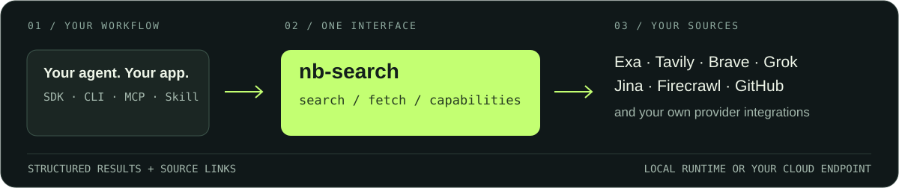

<div align="center">

<picture>
  <source media="(prefers-color-scheme: dark)" srcset="docs/assets/banner-dark.svg">
  
</picture>

**Search. Read. Research. One interface for your AI.**

[](https://nodejs.org/)
[](LICENSE)
[](https://nb-corp.github.io/nb-search/)

[Quick start](#quick-start) · [Documentation](https://nb-corp.github.io/nb-search/) · [Sources](https://nb-corp.github.io/nb-search/sources/) · [Agent Skill](SKILL.md)

**English** · [简体中文](README.zh-CN.md)

</div>

Stop wiring a different tool for every source. **nb-search** gives agents and applications one TypeScript interface for web search, web reading and research—while you choose the providers.

Use it inside your app, from a terminal, as an MCP server, or through an agent Skill. Run locally with your credentials, or connect the same client interface to your own [nb-search-cloud](https://github.com/NB-Corp/nb-search-cloud) service.

<p align="center"></p>

## Why nb-search?

- **Bring more than one source.** Exa, Tavily, Brave, Grok, Jina, Firecrawl, GitHub, and the opt-in Zhihu builtin. Combine search results or select a dedicated research operation. [Explore the catalog →](https://nb-corp.github.io/nb-search/sources/)
- **Research in parallel.** Send independent topics together. Use async jobs for long-running work, with status, cancellation and complete result retrieval.
- **Get usable output.** Structured results with source URLs, extracted documents, or typed research—not another wall of chat to reverse-engineer.
- **Keep your workflow.** SDK, CLI, MCP and Skill use the same runtime. Reuse your local provider configuration or connect a remote profile—without configuring every source in every assistant.

## Quick start

**Requires Node.js ≥ 24.15.** Install the CLI from the official npm registry:

```bash
npm install -g @nb-corp/nb-search@0.5.1 --registry=https://registry.npmjs.org
nb-search fetch "https://nodejs.org/en/about/releases/" --pipeline direct.fetch
```

The command returns JSON. Extracted text is in `documents[].content`; `status` tells you whether extraction succeeded. This direct-fetch example needs no provider key.

For a source checkout, pnpm is needed only to install dependencies and build:

```bash
git clone https://github.com/NB-Corp/nb-search.git
cd nb-search
pnpm install --frozen-lockfile
pnpm build
node scripts/nb-search.mjs fetch "https://nodejs.org/en/about/releases/" --pipeline direct.fetch
```

The **0.5.1 release** searches the general web with DuckDuckGo by default, without registration, an API key or lane selection:

```bash
node scripts/nb-search.mjs search "NASA James Webb telescope"
```

DuckDuckGo's public HTML endpoint may issue a challenge or rate limit; these are reported as errors, not empty results. Wait before retrying, or explicitly choose another configured provider. `github.repositories` remains available for repository search. Configured defaults and explicit choices take precedence, including an explicitly removed default; failures never silently switch to a paid source. A *lane* is a named source operation. [Explore configuration →](https://nb-corp.github.io/nb-search/guide/configuration) Provider pricing and limits still apply.

Direct HTML extraction and configurable URL routing are also available. Known GitHub raw text/repository JSON, npm metadata and PyPI JSON use Direct only by default; user rules can replace that list or restore your usual chain. Unmatched URLs still use the Direct-to-Jina default chain. Route decisions, actual attempts and content warnings are returned in receipts. [Routing configuration and host APIs →](docs/model-facing-lane-runtime.md#fetch)

## Multiple provider keys (local runtime)

Put up to 32 distinct keys, in priority order, in the existing credential environment variable, separated by commas: `NB_SEARCH_TAVILY_API_KEY="key-one,key-two"`. A single key remains valid. Custom `credential_slots.*.env` names use the same format. Keys are never included in config fingerprints or usage output. Configure scheduling per instance in `config.json` (schema version remains `"4"`):

```json
{
  "provider_instances": {
    "tavily.default": { "key_strategy": "priority", "balance_ttl_ms": 600000 }
  }
}
```

`key_strategy` defaults to `round-robin`; `priority` always selects the first available key, failing over in order. Both strategies quarantine 401/403 keys for the lifetime of the runtime, cool 429 keys using `Retry-After` (or 60 seconds), and retry 5xx/connection errors twice with bounded exponential backoff before moving to the next key. A 402 marks a key exhausted until its cache expires or a manual usage refresh restores it. State is in-memory and scoped to the provider instance/process (detached jobs each start a separate worker). The existing execution-level retry policy still applies after key-level attempts fail.

For supported providers, `createNbSearchRuntime().keyUsage({ provider_instance_id: 'tavily.default', refresh: true })` returns an array of key-indexed state and provider-reported usage, with no key values. Omit `refresh` to use a 10-minute TTL cache (`balance_ttl_ms` accepts 60,000–86,400,000 milliseconds). Avoid frequent forced refreshes because Tavily [limits usage checks to 10 per 10 minutes](https://docs.tavily.com/documentation/rate-limits#usage-endpoint-rate-limits).

Tavily's [key usage endpoint](https://docs.tavily.com/documentation/api-reference/endpoint/usage) reports key-level cycle usage/limit; Firecrawl's [team credit endpoint](https://docs.firecrawl.dev/api-reference/endpoint/credit-usage) reports **team-wide** remaining credits (the same balance can appear under multiple keys). Providers without a supported usage API return no usage entries. Exa's [per-key historical spend API](https://exa.ai/docs/reference/team-management/get-api-key-usage) requires a separate team service key and does not report remaining balance. `keyUsage()` is available on the local SDK runtime only, not on remote, CLI or MCP transports.

Tavily and Firecrawl searches and fetches do not query balances before dispatch; only an explicit `keyUsage()` call does. Zhihu is an exception: when `allow_paid` is false, its free-quota guard checks `GET /api/v1/quota` before dispatch.

## Opt in to Zhihu

The Zhihu builtin is opt-in. It does not add a provider instance, credential slot or lane to the defaults. Add all three explicitly to a schema-4 configuration, then select a lane. The `latency` and `cost` fields below are lane metadata; adjust them to your deployment's estimates rather than treating them as request limits:

```json
{
  "provider_instances": {
    "zhihu.manual": {
      "provider_id": "zhihu",
      "enabled": true,
      "credential_slot_id": "zhihu.manual",
      "base_url": "https://developer.zhihu.com",
      "options": {
        "allow_paid": false,
        "search_db": "all",
        "zhida_model": "zhida-fast-1p5",
        "search_path": "/api/v1/content/zhihu_search",
        "global_search_path": "/api/v1/content/global_search",
        "synthesis_path": "/v1/chat/completions",
        "quota_path": "/api/v1/quota"
      }
    }
  },
  "credential_slots": {
    "zhihu.manual": {
      "provider_id": "zhihu",
      "env": "NB_SEARCH_ZHIHU_API_KEY"
    }
  },
  "lanes": {
    "zhihu.search": {
      "provider_instance_id": "zhihu.manual",
      "operation_id": "search",
      "latency": "fast",
      "cost": "cheap"
    },
    "zhihu.global": {
      "provider_instance_id": "zhihu.manual",
      "operation_id": "global",
      "latency": "fast",
      "cost": "cheap"
    },
    "zhihu.synthesis": {
      "provider_instance_id": "zhihu.manual",
      "operation_id": "synthesis",
      "latency": "medium",
      "cost": "cheap"
    }
  }
}
```

Set `NB_SEARCH_ZHIHU_API_KEY` to `YOUR_API_KEY` in the environment that runs nb-search, then choose a lane explicitly:

```bash
node scripts/nb-search.mjs search "人工智能" --lane zhihu.search
node scripts/nb-search.mjs search "人工智能" --lane zhihu.global
node scripts/nb-search.mjs search "比较近期的人工智能研究趋势" --lane zhihu.synthesis
```

- `zhihu.search` sends `GET /api/v1/content/zhihu_search`. The trimmed query must be 2–100 characters, and the requested count is clamped to 1–10.
- `zhihu.global` sends `GET /api/v1/content/global_search`. The requested count is clamped to 1–20. `options.search_db` is `all` by default and also accepts `realtime` or `static`.
- `zhihu.synthesis` sends `POST /v1/chat/completions` and returns `nb-search.synthesis@1`. `options.zhida_model` defaults to `zhida-fast-1p5`; it also accepts `zhida-thinking-1p5`, `zhida-agent`, or any other non-empty custom model name.
- All three lanes support synchronous and asynchronous execution. The path options are `search_path`, `global_search_path`, `synthesis_path` and `quota_path`; the sample shows their official defaults.

The official `base_url` default is `https://developer.zhihu.com`. It is a URL prefix: the configured paths append to it without replacing the prefix. The same prefix behavior applies to Zhihu and to Tavily and Firecrawl usage requests. If you override the base URL, a neutral example is `https://relay.example.test/zhihu`.

With `allow_paid: false` (the default), the free-quota guard fails closed when quota is exhausted or cannot be verified. It caches only observations with more than 32 requests remaining, for at most 60 seconds, and makes in-process reservations synchronously. The daily quota resets at 00:00 Asia/Shanghai (UTC+8). Set `allow_paid: true` only as an explicit opt-in to wallet billing.

`keyUsage()` also reads `GET /api/v1/quota` and returns per-API request counters in `KeyUsage.usage.meters`. The legacy credits summary uses the `zhihu_search` meter, or the first available meter; a key is marked exhausted only when both `zhihu_search` and `global_search` have zero remaining requests.

## Search, fetch, inspect capabilities—and check key usage locally.

```bash
npm install @nb-corp/nb-search@0.5.1 --registry=https://registry.npmjs.org
```

```js
import { createNbSearchRuntime } from '@nb-corp/nb-search';

const search = createNbSearchRuntime();
const page = await search.fetch({
  action: 'run',
  source: {
    kind: 'url',
    url: 'https://nodejs.org/en/about/releases/'
  },
  pipeline: 'direct.fetch'
});

if (page.action === 'run' && page.execution === 'sync' && page.status === 'succeeded' && page.documents.length > 0) {
  console.log(page.documents[0].content);
}
```

This example reads a public URL, so it needs network access but no provider key. Add `search.search()` for retrieval and `search.capabilities()` to inspect available operations. [SDK examples, MCP setup and remote clients →](https://nb-corp.github.io/nb-search/guide/integrations)

TypeScript consumers should use `skipLibCheck: true` with the current bundled declarations. [Compatibility details →](https://nb-corp.github.io/nb-search/guide/integrations)

## Bring your own script lane

Point a configured `script` provider at your trusted local JavaScript or erasable TypeScript module. Export `execute(request, context)` (or `search(query, context)`) and return a results array. The standard CLI and SDK support both sync and detached async jobs—no custom CLI wrapper or code-registration boilerplate required.

The runnable [local catalog example](examples/script-lane/config.json) needs no network or credentials. Set `NB_SEARCH_CONFIG` to that file, then run `nb-search search "Node" --lane local.search`. Relative module paths are resolved against the config file's directory; SDK inline config paths use the caller's working directory.

Scripts are trusted code with the same permissions as the runtime, not sandboxed plugins. Use `context.logger` for stderr diagnostics and honor `context.signal`; do not write to CLI stdout. [Module API, TypeScript limits and deployment guidance →](https://nb-corp.github.io/nb-search/sources/custom)

## Pick your entry point

| You want to… | Start here |
| --- | --- |
| Give an assistant search and research | [Official nb-search Skill](SKILL.md) |
| Convert web pages or files to Markdown | [nb-extract](https://github.com/NB-Corp/nb-extract) — web/file-to-Markdown document conversion entry point |
| Build an app or connect an MCP host | [Integration guide](https://nb-corp.github.io/nb-search/guide/integrations) |
| Share provider credentials with a team | [nb-search-cloud](https://github.com/NB-Corp/nb-search-cloud) — self-hosted users, keys and usage |

## Go deeper

[Configuration](https://nb-corp.github.io/nb-search/guide/configuration) · [Fetch](https://nb-corp.github.io/nb-search/guide/fetch) · [Async jobs](https://nb-corp.github.io/nb-search/guide/jobs) · [Troubleshooting](https://nb-corp.github.io/nb-search/guide/troubleshooting) · [Upgrading](https://nb-corp.github.io/nb-search/guide/upgrading)

Found a broken source, an integration gap, or a better example? [Open an issue](https://github.com/NB-Corp/nb-search/issues) or send a focused PR. Keep credentials out of reports.

[MIT](LICENSE) · Built by [NB-Corp](https://github.com/NB-Corp)
