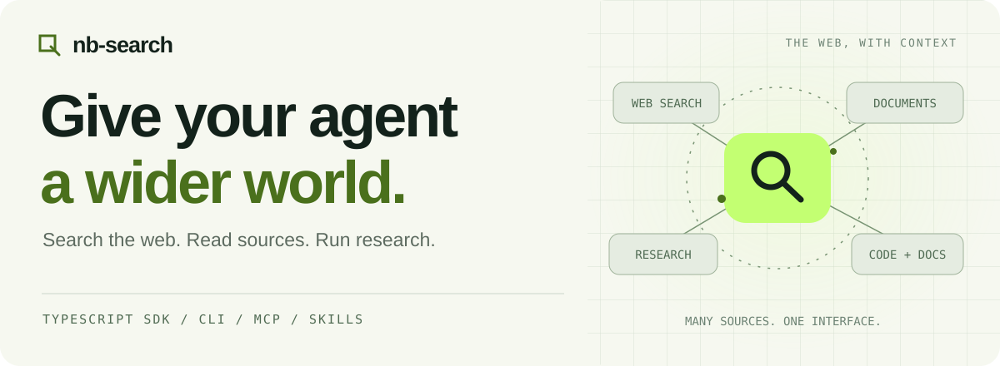

<div align="center">

<picture>
  <source media="(prefers-color-scheme: dark)" srcset="docs/assets/banner-dark.svg">
  
</picture>

**Unified web search, URL-to-Markdown extraction, RRF multi-source fusion, and async deep research for AI agents and TypeScript apps.**

[](https://www.npmjs.com/package/@nb-corp/nb-search)
[](https://github.com/NB-Corp/nb-search/actions/workflows/ci.yml)
[](https://nodejs.org/)
[](LICENSE)
[](https://nb-corp.github.io/nb-search/en/)

[Quick start](#quick-start) · [MCP & Skill](#mcp--agent-skill) · [Sources](#supported-sources) · [Comparison](#how-it-compares) · [Docs](https://nb-corp.github.io/nb-search/en/)

**English** · [简体中文](README.zh-CN.md)

</div>

Wiring separate MCP servers for Exa, Tavily, Firecrawl, Context7, and Playwright burns **15k–35k context tokens** before your first prompt, scatters API keys across assistant configs, and breaks on single-key `429` limits or 60-second `stdio` timeouts. **`@nb-corp/nb-search`** replaces that stack with **one 3-tool MCP server (~1.4k tokens)**, an **Agent Skill (~110 idle tokens)**, a **CLI**, and a **TypeScript SDK**—all running locally or against your self-hosted [nb-search-cloud](https://github.com/NB-Corp/nb-search-cloud) service.

<p align="center"></p>

## Why nb-search?

- **Context economy**: Load 3 MCP tools (`search`, `fetch`, `capabilities`, ~1.4k schema tokens) or mount the Agent Skill (~110 tokens at rest) instead of 20+ vendor tool definitions.
- **Zero-key instant start + BYOK**: Search the web (`duckduckgo.search`), GitHub (`github.repositories`), and library docs (`context7.docs`) or read URLs (`direct.fetch` + `jina.reader`) immediately with zero keys, then plug in Exa, Tavily, Brave, Firecrawl, Grok, Zhipu, SearXNG, or opt-in Zhihu keys as needed.
- **RRF multi-source fusion**: Query multiple engines in parallel (`--lanes exa.search,tavily.search,brave.search`), canonicalize URLs, deduplicate hits, and rank with Reciprocal Rank Fusion and per-source provenance.
- **32-key rotation & failover**: Supply comma-separated key pools per provider with automatic `429` `Retry-After` cooldowns, `402` quota-exhaustion skipping, `401`/`403` quarantine, and bounded `5xx` retries.
- **Direct-first URL credit protection**: Static HTML, GitHub raw/API responses, npm metadata, and PyPI JSON resolve locally via Defuddle (`direct.fetch`) first—surfacing Cloudflare or bot walls explicitly instead of wasting paid scrape credits.
- **Detached async jobs without 60s timeouts**: Run 10–15 minute deep research (`tavily.research`, `gma.research`), site crawls (`tavily.crawl`), and headless Chromium renders (`browser.render`) via `run`/`get`/`read`/`cancel`.

## Quick start

**Requires Node.js >= 24.15.** Install globally and run three zero-key commands right away:

```bash
npm install -g @nb-corp/nb-search

nb-search search "WebAssembly component model"
nb-search search "react useOptimistic" --lane context7.docs
nb-search fetch "https://nodejs.org/en/about/releases/" --pipeline direct.fetch
```

Every command writes structured `3.0` JSON to `stdout`:

```json
{
  "schema_version": "3.0",
  "action": "run",
  "execution": "sync",
  "status": "succeeded",
  "documents": [
    {
      "url": "https://nodejs.org/en/about/releases/",
      "source_lane": "direct.fetch",
      "content": "# Node.js Releases\n..."
    }
  ]
}
```

Public DuckDuckGo HTML challenges or rate limits fail explicitly rather than returning fake empty results, and errors never silently switch to a paid provider. Add your own keys to unlock RRF multi-engine fusion or detached async research:

```bash
export NB_SEARCH_EXA_API_KEY="YOUR_API_KEY"
export NB_SEARCH_TAVILY_API_KEY="YOUR_API_KEY"

nb-search search "PostgreSQL logical replication latency" --lanes exa.search,tavily.search --freshness py
nb-search search "2026 WebAssembly server runtime benchmarks" --lane tavily.research --execution async --idempotency-key wasm-2026
nb-search search get "<job_id>" --wait 240000
nb-search search read "<job_id>" --all
```

## MCP & Agent Skill

### MCP Server (`Claude Code` / `Codex` / `Cursor`)

Add `nb-search-mcp` to your host's `mcpServers` config (`env` is optional for zero-key sources):

```json
{
  "mcpServers": {
    "nb-search": {
      "command": "npx",
      "args": ["-y", "--package=@nb-corp/nb-search", "nb-search-mcp"],
      "env": {
        "NB_SEARCH_TAVILY_API_KEY": "YOUR_API_KEY",
        "NB_SEARCH_EXA_API_KEY": "YOUR_API_KEY"
      }
    }
  }
}
```

### Agent Skill & TypeScript SDK

- **Agent Skill (~110 idle tokens)**: After `npm install -g @nb-corp/nb-search`, point your agent's skill directory to `$(npm root -g)/@nb-corp/nb-search/skills/nb-search` (or `node_modules/@nb-corp/nb-search` in a project; see [`SKILL.md`](SKILL.md)).
- **TypeScript SDK**: Install `npm install @nb-corp/nb-search` (enable `skipLibCheck: true` in `tsconfig.json`; [integration details](https://nb-corp.github.io/nb-search/en/guide/integrations)):

```ts
import { createNbSearchRuntime } from '@nb-corp/nb-search';

const runtime = createNbSearchRuntime();
const hits = await runtime.search({ action: 'run', query: 'SQLite WAL concurrency' });
const page = await runtime.fetch({
  action: 'run',
  source: { kind: 'url', url: 'https://nodejs.org/en/about/releases/' },
  pipeline: 'direct.fetch'
});

if (page.action === 'run' && page.execution === 'sync' && page.status === 'succeeded') {
  console.log(page.documents[0]?.content);
}
const catalog = await runtime.capabilities();
```

## Supported sources

Full schemas, options, and endpoint contracts live in the [Sources Catalog](https://nb-corp.github.io/nb-search/en/sources/).

| Category | Built-in & Opt-in Providers | Lane / Pipeline IDs | Auth |
| --- | --- | --- | --- |
| **Zero-Key Out-of-the-Box** | DuckDuckGo (default), GitHub, Context7, Direct Fetch (Defuddle), Jina Reader, Wayback Machine | `duckduckgo.search`, `github.repositories`, `context7.docs`, `direct.fetch`, `jina.reader`, `wayback.fetch` | Keyless (optional token/key for higher GitHub, Context7, or Jina rate limits) |
| **BYOK Web & Regional Search** | Exa, Tavily, Brave, Firecrawl, Parallel, Zhipu, SearXNG, [Zhihu (opt-in)](https://nb-corp.github.io/nb-search/en/sources/web-search#zhihu) | `exa.search`, `tavily.search`, `brave.search`, `firecrawl.search`, `parallel.search`, `zhipu.search`, `searxng.search`, `zhihu.search`, `zhihu.global` | Provider API key (`searxng.search` needs `base_url`; Zhihu requires explicit config opt-in) |
| **BYOK & Browser URL Reading** | Exa Contents, Tavily Extract, Firecrawl Scrape, OpenAI-Compatible Fetch, Playwright Render, Local File/Inline | `exa.contents`, `tavily.extract`, `firecrawl.scrape`, `oac.fetch`, `browser.render` (async), `direct.local` (no egress) | Provider API key (`browser.render` uses optional `playwright >= 1.50.0`) |
| **Synthesis, Crawl, Deep Research & Custom Scripts** | Exa / Tavily / Grok / OAC / opt-in Zhihu Synthesis, Tavily Crawl, Tavily Research, Grok Multi-Agent Research, Local [Script](https://nb-corp.github.io/nb-search/en/sources/custom) | `exa.synthesis`, `tavily.synthesis`, `grok.synthesis`, `grok.x-synthesis`, `oac.synthesis`, `zhihu.synthesis`, `tavily.crawl`, `tavily.research`, `gma.research`, custom `.js`/`.ts` ([example](examples/script-lane/config.json)) | Provider key/endpoint or trusted local module |

Built-in URL routing (`kiki-common-direct@1`) pins known plain-text `raw.githubusercontent.com` files, `api.github.com` repository/README/release JSON, npm package metadata, and PyPI JSON to `direct.fetch` only—never appending paid fallbacks unless your `fetch.routing.rules` explicitly ask for them. [URL routing & host APIs →](https://nb-corp.github.io/nb-search/en/reference/runtime#fetch)

## Multi-key rotation & quota inspection

Pass up to 32 distinct comma-separated keys in any credential variable (`NB_SEARCH_TAVILY_API_KEY="key-one,key-two"`). Keys default to `round-robin`, or fail over in strict order with `"key_strategy": "priority"`:

```json
{
  "schema_version": "4",
  "provider_instances": {
    "tavily.default": { "key_strategy": "priority", "balance_ttl_ms": 600000 }
  }
}
```

Both strategies quarantine `401`/`403` keys for the runtime's lifetime, cool `429` keys using `Retry-After` (or 60s), skip `402` exhausted keys until TTL expiry or manual refresh, and retry `5xx`/network errors twice before rotating. In the local SDK, call `await runtime.keyUsage({ provider_instance_id: 'tavily.default', refresh: true })` to inspect redacted key state and remaining quota for supported providers without exposing secret values. See [Configuration & Multi-Key Rotation](https://nb-corp.github.io/nb-search/en/guide/configuration) for provider-specific meter rules.

## How it compares

| Capability | Stacking 4–5 Vendor MCPs | Multi-Vendor BYOK Wrappers (`mcp-omnisearch`) | Keyless Scrapers (`open-webSearch`) | `@nb-corp/nb-search` |
| --- | --- | --- | --- | --- |
| **Context Overhead** | ~15k–35k tokens across 20+ tools | ~4k–8k tokens across per-vendor tools | ~1k–2k tokens | **~1.4k tokens (3-tool MCP) / ~110 tokens (Skill)** |
| **Zero-Key Start** | No (keys required per server) | No (API keys required upfront) | Yes (public HTML scraping only) | **Yes (DuckDuckGo, GitHub, Context7, Defuddle, Jina, Wayback) + BYOK** |
| **Multi-Engine RRF Fusion** | Manual prompt-level merging | Single provider per call | Multi-engine HTML without API provenance | **URL canonicalization + RRF + per-source provenance** |
| **Multi-Key `429` Failover** | None | Single key per provider | None (IP rate-limited) | **Up to 32 keys/provider, `Retry-After` cooldown & `402` skip** |
| **URL Credit Protection** | Every URL hits paid scraper | Direct vendor scrape call | Basic HTML fetch | **Defuddle Direct-first + ordered URL routing + challenge detection** |
| **>60s Async Research & Render** | Hits 60s MCP `stdio` timeout | Sync call timeouts on long tasks | Not supported | **Detached `run`/`get`/`read`/`cancel` jobs (up to 60 min)** |

### FAQ

**MCP server or Agent Skill—which should I pick?**
Use the Agent Skill in CLI-capable coding agents (`Claude Code`, `Codex`, `OpenCode`) to keep idle context near ~110 tokens. Use `nb-search-mcp` in desktop or IDE hosts (`Claude Desktop`, `Cursor`) that expect MCP `stdio` tools.

**Does `nb-search` silently fall back to paid APIs when a free source fails?**
Never. Search errors on `duckduckgo.search` or explicit lanes fail closed, and Direct-only URL routes (`raw.githubusercontent.com`, `api.github.com`, npm, PyPI) never append paid scrapers unless you configure a custom chain.

**When should I use `nb-extract` or `paper-search-cli` instead?**
Use `nb-search` for web discovery, URL reading, RRF fusion, and deep research. Route local PDF/Office/OCR document conversion and asset export to [nb-extract](https://github.com/NB-Corp/nb-extract), and DOI/arXiv/patent/citation graphs to `paper-search-cli`.

**How can a team share keys without distributing `.env` files?**
Deploy [nb-search-cloud](https://github.com/NB-Corp/nb-search-cloud) and connect the same CLI (`--profile cloud`) or SDK (`createNbSearchRemoteClient()`) over [HTTP Protocol v1](https://nb-corp.github.io/nb-search/en/reference/remote-protocol).

## From source & deeper docs

To build and verify from a git checkout (`pnpm@10.33.0`):

```bash
git clone https://github.com/NB-Corp/nb-search.git
cd nb-search
pnpm install --frozen-lockfile && pnpm build
node scripts/nb-search.mjs capabilities
```

[Documentation](https://nb-corp.github.io/nb-search/en/) · [Configuration](https://nb-corp.github.io/nb-search/en/guide/configuration) · [URL Fetch & Routing](https://nb-corp.github.io/nb-search/en/guide/fetch) · [Async Jobs](https://nb-corp.github.io/nb-search/en/guide/jobs) · [CLI Reference](https://nb-corp.github.io/nb-search/en/reference/cli) · [Runtime Contract](https://nb-corp.github.io/nb-search/en/reference/runtime) · [`llms.txt`](https://nb-corp.github.io/nb-search/llms.txt)

Found a broken source or integration gap? [Open an issue](https://github.com/NB-Corp/nb-search/issues) (keep credentials out of reports). [MIT](LICENSE) · Built by [NB-Corp](https://github.com/NB-Corp)
