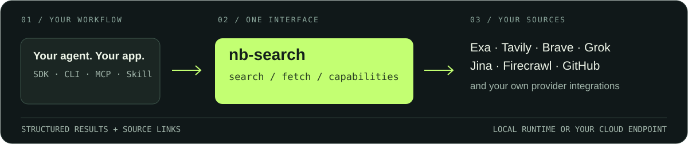

<div align="center">

<picture>
  <source media="(prefers-color-scheme: dark)" srcset="docs/assets/banner-dark.svg">
  
</picture>

**面向 AI Agent 与 TypeScript 应用的统一网页搜索、URL 转 Markdown、多源 RRF 融合与异步深度研究。**

[](https://www.npmjs.com/package/@nb-corp/nb-search)
[](https://github.com/NB-Corp/nb-search/actions/workflows/ci.yml)
[](https://nodejs.org/)
[](LICENSE)
[](https://nb-corp.github.io/nb-search/)

[快速开始](#快速开始) · [MCP 与 Skill](#mcp-与-agent-skill) · [支持的数据源](#支持的数据源) · [方案对比](#方案对比) · [在线文档](https://nb-corp.github.io/nb-search/)

[English](README.md) · **简体中文**

</div>

同时挂载 Exa、Tavily、Firecrawl、Context7 与 Playwright 等 5 个独立 MCP 服务，会在对话开始前消耗 **15k–35k 上下文 Token**，把 API 密钥分散在各个客户端配置中，且极易因单 Key `429` 限流或 `stdio` 60 秒超时而中断。**`@nb-corp/nb-search`** 用**单一 3 工具 MCP 服务（约 1.4k Token）**、**Agent Skill（静默仅约 110 Token）**、**CLI** 与 **TypeScript SDK** 统一替代整套碎片工具，支持本地直连或接入自托管 [nb-search-cloud](https://github.com/NB-Corp/nb-search-cloud) 服务。

<p align="center"></p>

## 为什么选择 nb-search？

- **极致省上下文**：仅暴露 `search`、`fetch`、`capabilities` 3 个 MCP 工具（约 1.4k Token），或挂载 Agent Skill（静默约 110 Token），告别 20+ 厂商工具 Schema 挤占窗口。
- **零配置即用 + 按需 BYOK**：开箱免密运行网页检索（`duckduckgo.search`）、GitHub 仓库发现（`github.repositories`）、框架文档查询（`context7.docs`）与网页提取（`direct.fetch` + `jina.reader`）；需要更高覆盖时按需接入 Exa、Tavily、Brave、Firecrawl、Grok、智谱、SearXNG 或显式启用知乎。
- **多源 RRF 去重融合**：单次请求并行检索多个引擎（`--lanes exa.search,tavily.search,brave.search`），自动完成 URL 规范化去重、倒数排名融合（RRF）与来源归属追踪。
- **32 密钥池轮转与容灾**：单个环境变量支持逗号分隔配置最多 32 把密钥，自动隔离 `401`/`403` 失效密钥、按 `Retry-After` 冷却 `429` 限流密钥、跳过 `402` 耗尽密钥并对 `5xx` 退避切换。
- **Direct 优先省额度路由**：静态网页、GitHub Raw/API、npm 与 PyPI 元数据默认优先走本地 Defuddle（`direct.fetch`）解析，遇到 Cloudflare 验证墙明确报错，避免白烧付费抓取积分。
- **后台异步免疫 60s 超时**：10–15 分钟深度研究（`tavily.research`、`gma.research`）、整站爬取（`tavily.crawl`）与 Playwright 渲染（`browser.render`）均支持脱离前台的 `run`/`get`/`read`/`cancel` 异步作业。

## 快速开始

**需要 Node.js >= 24.15。** 全局安装后即可免密运行三条命令：

```bash
npm install -g @nb-corp/nb-search

nb-search search "WebAssembly 组件模型"
nb-search search "react useOptimistic" --lane context7.docs
nb-search fetch "https://nodejs.org/en/about/releases/" --pipeline direct.fetch
```

所有命令均在 `stdout` 输出结构化 `3.0` JSON 信封：

```json
{
  "schema_version": "3.0",
  "action": "run",
  "execution": "sync",
  "status": "succeeded",
  "documents": [
    {
      "url": "https://nodejs.org/en/about/releases/",
      "source_lane": "direct.fetch",
      "content": "# Node.js Releases\n..."
    }
  ]
}
```

公共 DuckDuckGo HTML 端点若触发验证或限流会直接返回明确错误，绝不伪装为空结果，也不会静默切换到付费数据源。接入自有 API Key 后，即可一键启用多引擎 RRF 融合或后台异步研究：

```bash
export NB_SEARCH_EXA_API_KEY="YOUR_API_KEY"
export NB_SEARCH_TAVILY_API_KEY="YOUR_API_KEY"

nb-search search "PostgreSQL 逻辑复制延迟优化" --lanes exa.search,tavily.search --freshness py
nb-search search "2026 WebAssembly 服务端运行时基准对比" --lane tavily.research --execution async --idempotency-key wasm-2026
nb-search search get "<job_id>" --wait 240000
nb-search search read "<job_id>" --all
```

## MCP 与 Agent Skill

### MCP 服务器（`Claude Code` / `Codex` / `Cursor`）

在宿主的 `mcpServers` 中配置 `nb-search-mcp`（仅用免密源时可省略 `env`）：

```json
{
  "mcpServers": {
    "nb-search": {
      "command": "npx",
      "args": ["-y", "--package=@nb-corp/nb-search", "nb-search-mcp"],
      "env": {
        "NB_SEARCH_TAVILY_API_KEY": "YOUR_API_KEY",
        "NB_SEARCH_EXA_API_KEY": "YOUR_API_KEY"
      }
    }
  }
}
```

### Agent Skill 与 TypeScript SDK

- **Agent Skill（静默约 110 Token）**：执行 `npm install -g @nb-corp/nb-search` 后，将宿主的 Skill 路径指向 `$(npm root -g)/@nb-corp/nb-search/skills/nb-search`（项目内安装可使用 `node_modules/@nb-corp/nb-search`，执行协议见 [`SKILL.md`](SKILL.md)）。
- **TypeScript SDK**：安装 `npm install @nb-corp/nb-search`（`tsconfig.json` 建议开启 `skipLibCheck: true`，详见[集成指南](https://nb-corp.github.io/nb-search/guide/integrations)）：

```ts
import { createNbSearchRuntime } from '@nb-corp/nb-search';

const runtime = createNbSearchRuntime();
const hits = await runtime.search({ action: 'run', query: 'SQLite WAL 并发读写' });
const page = await runtime.fetch({
  action: 'run',
  source: { kind: 'url', url: 'https://nodejs.org/en/about/releases/' },
  pipeline: 'direct.fetch'
});

if (page.action === 'run' && page.execution === 'sync' && page.status === 'succeeded') {
  console.log(page.documents[0]?.content);
}
const catalog = await runtime.capabilities();
```

## 支持的数据源

各数据源的完整 Schema、参数与端点约定请参阅[数据源目录](https://nb-corp.github.io/nb-search/sources/)。

| 类别 | 内置与可选数据源 | Lane / Pipeline 标识 | 认证方式 |
| --- | --- | --- | --- |
| **免密开箱即用** | DuckDuckGo（默认）、GitHub、Context7、Direct Fetch (Defuddle)、Jina Reader、Wayback Machine | `duckduckgo.search`、`github.repositories`、`context7.docs`、`direct.fetch`、`jina.reader`、`wayback.fetch` | 免密钥（可选配 Token/Key 提升 GitHub、Context7、Jina 频控额度） |
| **BYOK 网页与区域搜索** | Exa、Tavily、Brave、Firecrawl、Parallel、智谱、SearXNG、[知乎 (opt-in)](https://nb-corp.github.io/nb-search/sources/web-search#zhihu) | `exa.search`、`tavily.search`、`brave.search`、`firecrawl.search`、`parallel.search`、`zhipu.search`、`searxng.search`、`zhihu.search`、`zhihu.global` | 服务商 API Key（`searxng.search` 仅需 `base_url`；知乎需显式配置启用） |
| **BYOK 与浏览器正文读取** | Exa Contents、Tavily Extract、Firecrawl Scrape、OpenAI 兼容提取、Playwright 渲染、本地文件/行内文本 | `exa.contents`、`tavily.extract`、`firecrawl.scrape`、`oac.fetch`、`browser.render`（异步）、`direct.local`（零外发） | 服务商 API Key（`browser.render` 需安装可选依赖 `playwright >= 1.50.0`） |
| **综合、整站爬取、深度研究与自定义脚本** | Exa / Tavily / Grok / OAC / 可选知乎直达综合、Tavily Crawl、Tavily Research、Grok 多代理研究、本地 [Script](https://nb-corp.github.io/nb-search/sources/custom) | `exa.synthesis`、`tavily.synthesis`、`grok.synthesis`、`grok.x-synthesis`、`oac.synthesis`、`zhihu.synthesis`、`tavily.crawl`、`tavily.research`、`gma.research`、本地 `.js`/`.ts`（[示例](examples/script-lane/config.json)） | 服务商密钥/端点或可信本地脚本模块 |

内置有序 URL 路由（`kiki-common-direct@1`）默认将 `raw.githubusercontent.com` 纯文本、`api.github.com` 仓库/README/Release JSON、npm 元数据与 PyPI JSON 固定至仅执行 `direct.fetch`，失败绝不静默追加第三方或付费抓取器，也可通过 `fetch.routing.rules` 自定义顺序链。[URL 路由与宿主契约 →](docs/model-facing-lane-runtime.md#fetch)

## 多密钥轮转与额度查询

任意凭据环境变量均支持以逗号分隔填入最多 32 把不重复密钥（如 `NB_SEARCH_TAVILY_API_KEY="key-one,key-two"`），默认按 `round-robin` 轮询，也可在 `config.json` 中设为 `priority` 按顺序主备切换：

```json
{
  "schema_version": "4",
  "provider_instances": {
    "tavily.default": { "key_strategy": "priority", "balance_ttl_ms": 600000 }
  }
}
```

两种策略均会在当前运行时周期内隔离 `401`/`403` 密钥、按 `Retry-After`（默认 60 秒）冷却 `429` 密钥、在缓存期内跳过 `402` 耗尽密钥，并对 `5xx`/网络异常退避重试两次后切往下一把密钥。本地 SDK 可调用 `await runtime.keyUsage({ provider_instance_id: 'tavily.default', refresh: true })` 查询已脱敏的密钥健康状态与剩余额度。各服务商的额度计量细节见[配置与多密钥调度指南](https://nb-corp.github.io/nb-search/guide/configuration)。

## 方案对比

| 能力维度 | 叠加 4–5 个厂商官方 MCP | 多源 BYOK 聚合封装 (`mcp-omnisearch`) | 纯免密爬虫工具 (`open-webSearch`) | `@nb-corp/nb-search` |
| --- | --- | --- | --- | --- |
| **上下文开销** | 20+ 工具占用约 15k–35k Token | 按厂商拆分工具约 4k–8k Token | 约 1k–2k Token | **约 1.4k Token（3 工具 MCP）/ 约 110 Token（Skill）** |
| **零密钥启动** | 不支持（每个服务均需配 Key） | 不支持（需预先配置商业 Key） | 支持（仅限公共网页抓取） | **支持（DuckDuckGo、GitHub、Context7、Defuddle、Jina、Wayback）+ BYOK** |
| **多引擎 RRF 融合** | 需模型在上下文手工合并 | 单次仅调单一来源 | 多引擎 HTML 拼接，无官方 API 溯源 | **内置 URL 规范化去重 + RRF 融合 + 来源归属追溯** |
| **多 Key `429` 容灾** | 无 | 单服务商仅支持单 Key | 无（受单机 IP 频控限制） | **单源最多 32 Key 轮转、`Retry-After` 冷却与 `402` 跳过** |
| **URL 抓取额度保护** | 每次读网页均消耗付费积分 | 直接请求商业抓取接口 | 仅基础 HTML 提取 | **Defuddle Direct 优先 + 有序 URL 路由 + 验证墙识别** |
| **>60s 深度研究与渲染** | 易触发 MCP `stdio` 60 秒超时 | 长任务同步阻塞超时 | 不支持 | **后台脱机 `run`/`get`/`read`/`cancel` 异步作业（最长 60 分钟）** |

### 常见问题

**MCP 服务与 Agent Skill 该选哪个？**
在支持本地命令行的编码 Agent（如 `Claude Code`、`Codex`、`OpenCode`）中优先挂载 Agent Skill，静默上下文仅约 110 Token。在 `Claude Desktop`、`Cursor` 等桌面或 IDE 宿主中配置 `nb-search-mcp`。

**免费源失败时会自动切往付费 API 扣费吗？**
绝不会。`duckduckgo.search` 或显式指定的搜索源出错会直接报错；命中内置 Direct 规则（`raw.githubusercontent.com`、`api.github.com`、npm、PyPI）的 URL 也不会静默追加付费抓取器。

**什么时候该用 `nb-extract` 或 `paper-search-cli`？**
网页检索、URL 正文提取、多源融合与深度研究用 `nb-search`。本地 PDF/Office/OCR 转换与网页媒体导出交由 [nb-extract](https://github.com/NB-Corp/nb-extract)，学术论文、专利、DOI/arXiv 与引文网络检索交由 `paper-search-cli`。

**团队如何共享密钥而不分发 `.env` 文件？**
部署自托管 [nb-search-cloud](https://github.com/NB-Corp/nb-search-cloud) 服务，通过 CLI `--profile cloud` 或 `createNbSearchRemoteClient()` 走 [HTTP 协议 v1](docs/remote-protocol.md) 统一接入。

## 从源码构建与进阶文档

从源码检出构建与调试（需 `pnpm@10.33.0`）：

```bash
git clone https://github.com/NB-Corp/nb-search.git
cd nb-search
pnpm install --frozen-lockfile && pnpm build
node scripts/nb-search.mjs capabilities
```

[配置与凭据](https://nb-corp.github.io/nb-search/guide/configuration) · [正文抓取与路由](https://nb-corp.github.io/nb-search/guide/fetch) · [异步任务](https://nb-corp.github.io/nb-search/guide/jobs) · [故障排查](https://nb-corp.github.io/nb-search/guide/troubleshooting) · [CLI 参考](docs/cli.md) · [运行时契约](docs/model-facing-lane-runtime.md) · [English Overview](https://nb-corp.github.io/nb-search/en/) · [`llms.txt`](https://nb-corp.github.io/nb-search/llms.txt)

发现来源异常或集成问题？欢迎[提交 Issue](https://github.com/NB-Corp/nb-search/issues)（请勿在报告中附带真实密钥）。[MIT](LICENSE) · [NB-Corp](https://github.com/NB-Corp)
